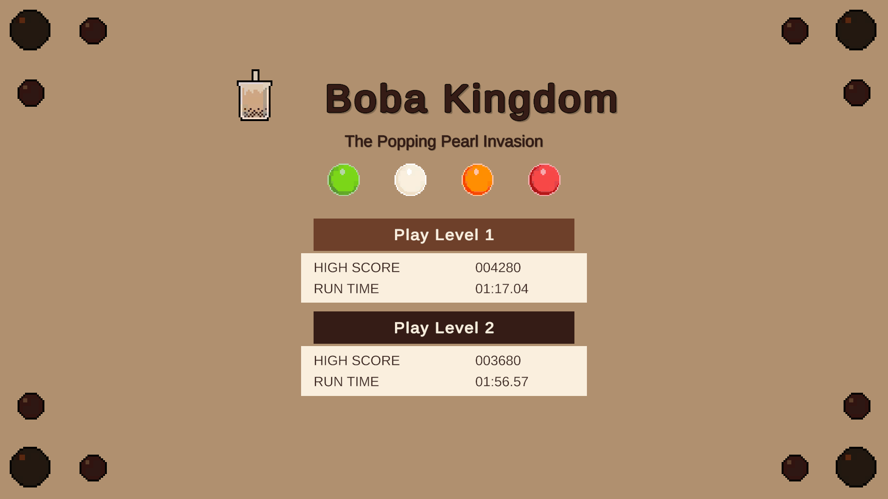
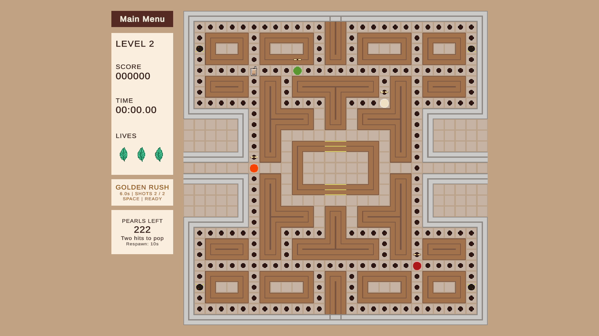

# Boba Kingdom
### The Popping Pearl Invasion

[English](README.md) | [繁體中文](README.zh-TW.md)

一款以珍奶為主題的 2D 遊戲。玩家要操作奶茶收集珍珠，同時避開到處亂竄的爆爆珠。

## 關於這個專案

這是我在 UTS 修習 Introduction to Game Development 時製作的課程作業。

作業以 Pac-Man 的玩法為基礎，要求做出自己的主題與視覺設計，並完成：

- Unity 2D 遊戲與自製像素美術。
- 主選單、關卡、計分、生命與最高分紀錄。
- 角色動畫、背景音樂與主要互動音效。
- 四種不同敵人行為，以及一個有新玩法的創新關卡。
- 以 Git 分支記錄開發過程。

課程結束後，我繼續補完玩法、調整介面，整理成現在的版本。

## 設計概念

身為手搖成癮者兼珍珠擁護者，我對手搖杯的要求是非常嚴格的
－－化學爆爆珠都是邪魔歪道。

於是有了玩家操控奶茶，要在迷宮裡收集珍珠和冰塊（保冰用），敵人則是不同口味的爆爆珠的構想。

## 怎麼玩

- **WASD**：移動。
- **Space**：在第二關發射珍珠。

**第一關**保留經典迷宮玩法：收集珍珠、避開爆爆珠；吃到大珍珠後，可以暫時反過來追牠們。

**第二關**加入珍珠射擊。爆爆珠會主動追過來，需要命中兩次才能擊滅，但會在 10 秒後從中央滿血重生。吃到大珍珠時會進入 Golden Rush，暫時擁有兩發充能。

兩關都是吃完全部珍珠就能獲勝。

## 美術與音樂

奶茶、珍珠、爆爆珠、茶葉生命圖示和迷宮場景的像素素材，都是自己畫的。

背景音樂與音效取自 Mixkit 的免費素材。

## 遊戲畫面

[查看更多遊戲截圖](Screenshots/README.md)

---

使用 Unity 2023.2.10f1 製作，目前有 Windows 64 位元版本。
